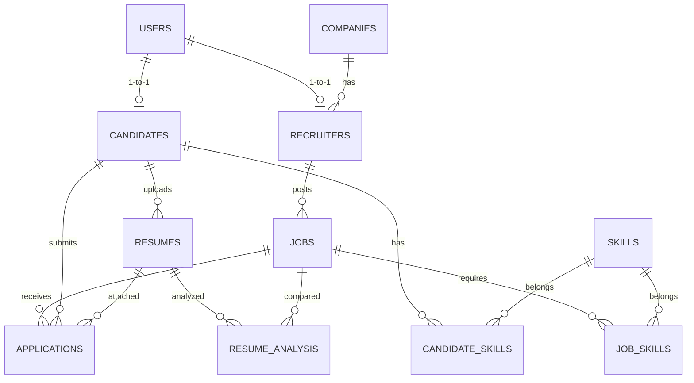

# SkillSphere – Next-Gen Career & Job Portal

> **SkillSphere** is an enterprise-grade full-stack career and hiring intelligence portal featuring **optical character recognition (OCR) resume parsing**, an **explainable resume-to-job skill matching algorithm**, an **interactive ATS Kanban pipeline**, and an aesthetic **Glassmorphic UI** powered by React, Tailwind CSS, GSAP, and Framer Motion.

---

## 🌟 Highlights & Key Features

* **Glassmorphism Design System**: Dark-mode futuristic neon-glass theme (`#060911` with cyan, purple, and emerald glowing accents, `backdrop-blur-xl bg-white/10 border border-white/20 shadow-xl`).
* **GSAP & Framer Motion Animations**:
  * GSAP ScrollTrigger parallax scrolling, floating 3D elements, staggered card reveals.
  * Framer Motion page transitions, spring modals, and animated circular radial gauges.
* **100% Normalized Relational Database**: 11 normalized tables via SQLAlchemy with strict foreign key constraints and cascade actions (supports SQLite out of the box and PostgreSQL in production).
* **Smart OCR Resume Extraction Engine**:
  * Accepts PDF, JPG, JPEG, and PNG files up to 10MB.
  * Image preprocessing (grayscale, contrast boost, sharpening, and thresholding).
  * Page-wise PDF parsing and heuristic entity extraction (Candidate Name, Email, Phone, Degrees, Experience, and 150+ canonical tech skills).
  * Real-time preview editor allowing candidates to review and adjust extracted fields before saving to profile.
  * Robust error handling and fallback so unreadable or empty files never crash the server.
* **Explainable Resume-to-Job Skill Matching**:
  * Compares candidate skills against job requirements.
  * Calculates exact match percentage + skill depth weighting.
  * Categorizes **Matched Skills** (emerald chips) vs. **Skill Gaps** (amber chips).
  * Provides explainable, human-readable recommendations.
* **Applicant Tracking System (ATS)**:
  * Dual-mode recruiter interface: **Interactive Kanban Board** & **Filterable Table View**.
  * 6 workflow stages: `Applied` ➔ `Under Review` ➔ `Shortlisted` ➔ `Interview` ➔ `Selected` (or `Rejected`).
  * One-click stage modification and candidate resume inspector.
  * **Bonus Feature**: Export applicants to CSV with one click (`/recruiter/export-applicants`).
* **Candidate Job Center**:
  * Multi-vector job filter matrix (keyword, location, job type, experience, required skills).
  * Duplicate application prevention (returns clear 400 error if applied more than once).
  * Application tracker with visual stage progression stepper and withdrawal capability.
* **System Superadmin Governance**:
  * Platform-wide telemetry (users by role, jobs distribution, application success rate, average match score).
  * User management (account deactivation toggle, permanent deletion).
  * Job moderation (disable/close inappropriate jobs).

---

## 📐 Normalized Database Schema (11 Tables)

SkillSphere implements an 11-table relational architecture designed with SQLAlchemy:



1. **`users`**: `user_id` (PK), `name`, `email`, `password_hash`, `role` (`job_seeker`, `recruiter`, `admin`), `created_date`, `is_active`.
2. **`candidates`**: `candidate_id` (PK), `user_id` (FK), `profile_details`, `phone`, `location`, `education`, `experience`.
3. **`recruiters`**: `recruiter_id` (PK), `user_id` (FK), `company_id` (FK), `recruiter_details`, `designation`, `phone`.
4. **`companies`**: `company_id` (PK), `company_name`, `description`, `contact_info`, `website`, `location`.
5. **`resumes`**: `resume_id` (PK), `candidate_id` (FK), `file_name`, `file_path`, `file_type`, `upload_date`, `processing_status`, `extracted_text`.
6. **`skills`**: `skill_id` (PK), `skill_name` (Unique index).
7. **`candidate_skills`**: `candidate_id` (FK), `skill_id` (FK) - Composite PK.
8. **`jobs`**: `job_id` (PK), `recruiter_id` (FK), `title`, `description`, `location`, `experience`, `job_type`, `salary_range`, `status` (`active`/`closed`), `created_date`.
9. **`job_skills`**: `job_id` (FK), `skill_id` (FK) - Composite PK.
10. **`applications`**: `application_id` (PK), `job_id` (FK), `candidate_id` (FK), `resume_id` (FK), `application_date`, `status` (`Applied`, `Under Review`, `Shortlisted`, `Interview`, `Selected`, `Rejected`), `cover_note`.
11. **`resume_analysis`**: `analysis_id` (PK), `resume_id` (FK), `job_id` (FK), `match_score`, `matched_skills`, `missing_skills`, `recommendations`, `analysis_date`.

---

## 🚀 Quick Start Guide

### 1. Prerequisites
- **Python 3.10+**
- **Node.js 18+ & npm**

---

### 2. Backend Setup

```bash
# Navigate to backend directory
cd backend

# Create & activate a virtual environment
python -m venv venv

# Windows
.\venv\Scripts\activate

# macOS / Linux
source venv/bin/activate

# Install dependencies
pip install -r requirements.txt

# Run seed script to populate demo users, companies, and jobs
python app/seed.py

# Start FastAPI server
uvicorn app.main:app --reload --port 8000
```

* API Docs Swagger UI: [http://localhost:8000/docs](http://localhost:8000/docs)
* Health Check: [http://localhost:8000/api/health](http://localhost:8000/api/health)

---

### 3. Frontend Setup

```bash
# Open a new terminal and navigate to frontend directory
cd frontend

# Install npm dependencies
npm install

# Start Vite React development server
npm run dev
```

* Frontend Portal: [http://localhost:5173](http://localhost:5173)

---

### 4. Running with Docker (Optional Bonus)

```bash
# Launch database, backend, and frontend containers in one command
docker-compose up --build
```
* Web Portal: `http://localhost:3000`
* Backend API: `http://localhost:8000/docs`

---

## 🔑 Pre-Seeded Demo Credentials

You can test any role with **1-click Demo Buttons on the Login Page**, or use these credentials:

| Role | Email | Password | Pre-loaded Context |
| :--- | :--- | :--- | :--- |
| **Job Seeker** | `candidate@skillsphere.com` | `password123` | Alex Rivera (Full-Stack profile, active applications, resume) |
| **Recruiter** | `recruiter@skillsphere.com` | `password123` | Sarah Jenkins (TechNova Labs, posted jobs, ATS candidates) |
| **Admin** | `admin@skillsphere.com` | `password123` | Elena Rostova (Platform analytics, user moderation) |

---

## 🧪 Automated Test Suite

SkillSphere includes a comprehensive `pytest` test suite covering authentication, OCR parsing, match algorithms, duplicate application prevention, and admin metrics.

```bash
# Run test suite from repository root
$env:PYTHONPATH="backend"; backend\venv\Scripts\pytest backend\tests -v
```

### Test Results
```
backend/tests/test_api.py::test_resume_matching_algorithm PASSED         [ 14%]
backend/tests/test_api.py::test_ocr_extraction_and_field_parsing PASSED  [ 28%]
backend/tests/test_api.py::test_auth_login_verification PASSED           [ 42%]
backend/tests/test_api.py::test_job_listing_and_filtering PASSED         [ 57%]
backend/tests/test_api.py::test_duplicate_application_prevention PASSED  [ 71%]
backend/tests/test_api.py::test_recruiter_applicant_tracking_and_status_update PASSED [ 85%]
backend/tests/test_api.py::test_admin_analytics_metrics PASSED           [100%]


---

## 📡 Minimum API Coverage

| Method | Endpoint | Purpose | Access |
| :--- | :--- | :--- | :--- |
| `POST` | `/api/v1/auth/register` | Register new user (job seeker or recruiter) | Public |
| `POST` | `/api/v1/auth/login` | Authenticate user & return JWT token | Public |
| `GET` | `/api/v1/auth/me` | Fetch active user profile and role details | Authenticated |
| `POST` | `/api/v1/resume/upload` | Upload resume (PDF/Image <= 10MB), run OCR, extract fields | Candidate |
| `GET` | `/api/v1/resume/profile` | Retrieve candidate profile and parsed resumes | Authenticated |
| `PUT` | `/api/v1/resume/update-profile` | Save reviewed OCR fields & custom skills | Candidate |
| `POST` | `/api/v1/resume/analyze` | Calculate match score, matched & missing skills | Candidate |
| `GET` | `/api/v1/jobs` | Search & filter jobs by keyword/location/type/skills | Public / Auth |
| `POST` | `/api/v1/jobs` | Create new job opening with required skill tags | Recruiter / Admin |
| `GET` | `/api/v1/jobs/{id}` | Retrieve comprehensive job opening details | Public / Auth |
| `PUT` | `/api/v1/jobs/{id}` | Update job spec or toggle active/closed status | Recruiter / Admin |
| `DELETE` | `/api/v1/jobs/{id}` | Remove job opening | Recruiter / Admin |
| `POST` | `/api/v1/jobs/{id}/apply` | Submit job application (prevents duplicates) | Candidate |
| `GET` | `/api/v1/applications` | View candidate submitted applications history | Candidate |
| `PUT` | `/api/v1/applications/{id}/status`| Advance ATS stage (Applied, Review, Interview, etc.) | Recruiter / Admin |
| `POST` | `/api/v1/applications/{id}/withdraw`| Withdraw active application | Candidate |
| `GET` | `/api/v1/recruiter/applicants` | Fetch candidate applications with skill filters | Recruiter / Admin |
| `GET` | `/api/v1/recruiter/stats` | Recruiter ATS metrics (jobs, candidates, interviews)| Recruiter / Admin |
| `GET` | `/api/v1/recruiter/export-applicants`| Export applicant dataset as downloadable CSV | Recruiter / Admin |
| `GET` | `/api/v1/admin/analytics` | Platform-wide counts & match score metrics | Admin |
| `GET` | `/api/v1/admin/users` | List all platform users | Admin |
| `PUT` | `/api/v1/admin/users/{id}/toggle-status`| Activate or deactivate a user account | Admin |
| `DELETE` | `/api/v1/admin/users/{id}` | Permanently remove user account | Admin |
| `GET` | `/api/v1/admin/jobs` | Moderation view of all platform job postings | Admin |
| `PUT` | `/api/v1/admin/jobs/{id}/moderate` | Moderation toggle for job status | Admin |

---

## 🛠️ Tech Stack Architecture

* **Frontend**: React 18, Vite 5, Tailwind CSS 3, Lucide React, GSAP 3 (ScrollTrigger), Framer Motion 11, Axios, Canvas Confetti.
* **Backend**: Python 3.10+, FastAPI, SQLAlchemy 2.0, Pydantic v2, python-jose (JWT), bcrypt, PyPDF, Pillow (PIL), PyTest.
* **OCR Pipeline**: Image contrast & noise enhancement, PyPDF page-by-page extractor, Tesseract wrapper, regex entity parsers for name/email/phone/degrees/experience, and canonical dictionary matching across 150+ tech skills.
* **Database**: PostgreSQL / SQLite (11 normalized tables with foreign keys and cascade actions).
* **Containerization**: Docker & Docker Compose multi-stage builds.
=======
# SkillSphere
>>>>>>> 5110990c0d30407f9e41cc1e136bc3fce05d5ebc
